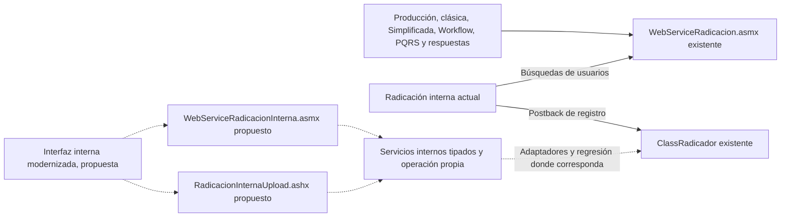

# Diagnóstico del WebService de radicación y sus consumidores

`WebServiceRadicacion.asmx` **es compartido por varios módulos**. La radicación interna no es su único consumidor y su registro principal actual tampoco se realiza mediante ese servicio: el botón del formulario ejecuta el code-behind, que llama a `ClassRadicador.Registra_Radicacion_entrante_interna`.

Modificar los métodos existentes para admitir terceros, archivos previos o resultados nuevos puede afectar Producción, respuestas, radicación clásica/Simplificada, Workflow y PQRS. La recomendación es conservar los contratos del servicio actual y usar la frontera propia ya propuesta para las nuevas operaciones internas. Esto reduce el acoplamiento HTTP; las clases, tablas y almacenamiento que se reutilicen siguen requiriendo análisis de impacto.

| Referencia | Resultado |
|---|---|
| Fecha y base | 2026-11-26; commit `b3353753` |
| Servicio existente | [WebServiceRadicacion.asmx](../../../webservice/WebServiceRadicacion.asmx), clase en [WebServiceRadicacion.asmx.vb](../../../webservice/WebServiceRadicacion.asmx.vb) |
| Superficie expuesta | 40 atributos `WebMethod`; 39 habilitan sesión. El restante es `HelloWorld`. |
| Inventario estático | 2.831 archivos de código rastreados examinados; 64 líneas de referencia no comentadas a la ruta del ASMX en 31 archivos. |
| Alcance del conteo | Incluye llamadas, configuración de consumidores y generación de controles. No son 31 módulos ni una medición de tráfico. Las URLs dinámicas pueden ampliar los consumidores efectivos. |
| Servicio interno propuesto | `webservice/WebServiceRadicacionInterna.asmx`: todavía no existe. Es una propuesta en N12/P02, distinta del servicio compartido actual. |
| Upload interno propuesto | `generic_control/RadicacionInternaUpload.ashx`: todavía no existe; es el transporte de recepción para el control nuevo de D-RI-05. |
| Límite de la revisión | Lectura de código y referencias; sin invocar servicios, iniciar sesión, consultar bases, cargar archivos ni registrar documentos. |

## Cómo usa el servicio la radicación interna actual

| Recorrido | Evidencia | Contrato y estado observado |
|---|---|---|
| Selector tokenizado de usuarios | [JavaScript interno](../../../js/radicacion/WebFormRadicacionEntranteInterna.js), `toke_ini`, líneas 104/137/145; [generador](../../../Gestion/ClassGaProducionDocumental.vb), línea 5234 | Inicialización del control `tokenize-callable-demo1` y llamada a `GetLista_usuarios_gestion_tokenize`. Devuelve elementos `{text,value}` con identidad interna. La ejecución efectiva depende de que el control y sus plugins estén disponibles. |
| Autocomplete de usuarios | Mismo JavaScript, `service_usuarios_gestion_text`, líneas 188/206 | Referencia `GetLista_usuarios_gestion`, que devuelve una lista de cadenas. La invocación de inicialización de la línea 71 está comentada. Existe el código consumidor, pero no se acredita que ese recorrido esté activo en la configuración actual. |
| Usuario que radica/remitente actual | [Code-behind interno](../../../radicador/WebFormRadicacionEntranteInterna.aspx.vb), `Page_Load`, línea 44 | Llena `RE_DropDownList_user_radica` mediante `Class_remit_dest_interno`; no debe confundirse con los buscadores anteriores ni cambiarse globalmente su identidad para incorporar terceros. |
| Registro del radicado | Mismo code-behind, `Buttonradicar_entrante_Click`, líneas 244/286 | Postback → `ClassRadicador.Registra_Radicacion_entrante_interna`. Conserva dependencias con plantilla, sesión, expediente, documentos y efectos posteriores. No llama a un WebMethod de registro interno en este ASMX. |

No debe interpretarse la presencia de una URL en una función como prueba de que todos los recorridos se ejecutaron en el ambiente. El diagnóstico diferencia código de integración, inicialización comentada y funcionamiento verificado por lectura.

## Otros módulos que lo consumen

| Familia | Consumidor representativo | Métodos o uso localizado |
|---|---|---|
| Producción documental | [WebFormProducionDocumental.js](../../../js/gestion/WebFormProducionDocumental.js), líneas 425/485/2196/2399/2454 | Usuarios, `Set_compartir_nivel`, `Getactualiza_service`, documentos de Producción. |
| Radicación clásica | [WebFormRadicacionEntrante.js](../../../js/radicacion/WebFormRadicacionEntrante.js), líneas 469/1060/1133/1453/1766 | Catálogos/documentos, rótulo, checklist y destinatarios; también construye nombres de método dinámicos. |
| Radicación Simplificada | [Web_form_radicacion_simpilificada.js](../../../js/RadicadorSimplificado/Web_form_radicacion_simpilificada.js), líneas 336/2195 | Catálogo documental mediante `service_source_list_item_control_general_documento_radicado`. Tiene además su propio `WebService_radicacion_Simplificada.asmx`; ambos conviven. |
| Respuestas | [WebFormRespuestaRadicado.js](../../../js/radicacion/WebFormRespuestaRadicado.js), líneas 262/405/426/575/633 | Usuarios y correos; caché/listas de destinatarios de respuesta. La gestión de respuestas continúa en su módulo según D-RI-03. |
| Notificaciones y correspondencia | [WebFormNotificar.js](../../../js/radicacion/WebFormNotificar.js), líneas 96/167/201; [gestión de trámite](../../../js/gestion_correspondencia/WebForm_interface_gestion_tramite.js), líneas 2383/2478/2504 | Listas de correos y `Add_correos_cache_tokenize`. |
| Workflow | [Webworkflow.js](../../../js/workflow/Webworkflow.js), líneas 2141/2180; [relación flujo/trámite](../../../js/workflow/WebFormWorkflowRelacionFlujoTramite.js), línea 165 | Configuración del cargador documental y `Get_lista_Tramites`. |
| PQRS público | [WebFormPqrsPrincipal.js](../../../js/RadicadorSimplificado/Publico/WebFormPqrsPrincipal.js), líneas 413/475/565; [WebFormPqrsGestion.js](../../../js/RadicadorSimplificado/Publico/WebFormPqrsGestion.js), línea 202 | Validación/alta de peticionario y `Service_radicacion_pqrsd`. No es solo un servicio de consulta interna. |
| Expedientes y clasificación | [WebFormGaGestionExpediente.js](../../../js/gestion/WebFormGaGestionExpediente.js), línea 1218; [WebFormGaconsultaclasificacion.js](../../../js/gestion/WebFormGaconsultaclasificacion.js), líneas 102/151 | Documentos y expedientes de clasificación. |
| Compartidos, revisión y aprobaciones | [revisión de documentos](../../../js/gestion/WebFormDocumentosCompartidosRevision.js), líneas 237/398; [solicitudes por aprobar](../../../js/radicacion/WebFormListaSolicitudesPorMiAprobacion.js), líneas 129/269 | Consultas de documentos y `update_radic_plantilla_radicado`. |
| Guías y controles dinámicos | [WebFormRaGestionarGuias.aspx](../../../radicador/WebFormRaGestionarGuias.aspx), línea 421; [ClassRadicador.vb](../../../radicador/ClassRadicador.vb), líneas 12495/12525/12559 | `AutoCompleteExtender.ServicePath` y generación de controles con método/contexto configurables. |
| Clientes genéricos | [ASMXClient.js](../../../js/java_general/ASMXClient.js), línea 4; [general_control_java.js](../../../js/java_general/general_control_java.js), línea 2686; [ubicacion_code_java.js](../../../js/java_general/ubicacion_code_java.js), línea 28 | URL base y nombre de método dinámico. El conteo de URLs literales no cubre por sí solo todas sus invocaciones. |

El proyecto registra el ASMX como Content y su code-behind como Compile, en `GestionDocumental-Docuarchi.net.vbproj`, líneas 8509/9931. Cambiar/eliminar su ruta o clase también afecta publicación.

Hay además siete archivos VB con `Imports ...WebServiceRadicacion`. Un `Imports` no demuestra una llamada HTTP. Sí obliga a revisar dependencias de compilación antes de mover tipos: por ejemplo, [Class_municipio_radicacion.vb](../../../radicador/Class_municipio_radicacion.vb) y [Class_ra_respuesta_tipo.vb](../../../radicador/Class_ra_respuesta_tipo.vb) utilizan `rad_drow_lista`, declarado dentro de la clase del servicio. Crear otro ASMX no exige mover esos tipos ni desarmar el existente.

## Contratos compartidos especialmente sensibles

### Los dos buscadores de usuarios tienen consumidores y formatos distintos

`GetLista_usuarios_gestion`, línea 368, tiene referencias directas desde Producción, solicitudes de aprobación, respuestas y el código de radicación interna. Acepta `DName`, procesa nombres separados por comas y retorna cadenas con ID, nombre y cargo.

`GetLista_usuarios_gestion_tokenize`, línea 671, tiene referencias directas desde Producción y radicación interna. También acepta `DName`, pero retorna objetos con `text` y `value`.

Agregar terceros a cualquiera de esas listas o cambiar su respuesta puede hacer que otra pantalla interprete un ID de tercero como usuario interno, rompa el autocomplete o pierda la selección. El nuevo remitente tipado debe tener su contrato propio; no cambiar globalmente el significado de estos buscadores para resolver P03.

### El servicio mezcla consultas y operaciones con efectos

Ejemplos leídos en el code-behind del servicio:

- `Set_compartir_nivel`, línea 313: delega cambios de permisos de nivel y utiliza la selección de Producción en sesión.
- `Service_registra_actualiza_plantilla_usuario_externo`, línea 135: delega registro/actualización de un peticionario PQRS.
- `update_radic_plantilla_radicado`, línea 1449: recibe una cadena, la transforma y la pasa a `MYSQL_INSERT_COMMNAD`; no es una consulta inocua.
- `Service_radicacion_pqrsd`, línea 2040: prepara archivos y delega a `ClassRadicador.Registra_radicado_pqr`.

No debe reutilizarse el servicio como si todo método fuera un catálogo sin efectos. Tampoco añadir el nuevo upload o la confirmación interna a uno de esos recorridos por compartir el nombre «radicación».

### El contexto de sesión es parte del comportamiento existente

39 WebMethods habilitan sesión. Algunos obtienen datos como `DG_ID_TRAMITE`, `DG_TIPO_TRAMITE`, `DG_ID_CONFIG_DIGITALIZACION`, plantilla PQRS o selección de Producción de la sesión. `service_source_list_item_control_general_documento_radicado`, línea 504, es un ejemplo de catálogo dependiente del trámite seleccionado.

Una operación nueva no debe sobrescribir ese contexto para satisfacer una función compartida: podría afectar otra pantalla o pestaña de la misma sesión. El nuevo servicio debe resolver operación/revisión/actor y recursos propios, con adaptadores acotados cuando se reutilice lógica. `EnableSession=True` por sí solo tampoco acredita autorización funcional sobre cada recurso.

### Hay defectos de consulta que no conviene copiar al contrato nuevo

En ambos buscadores de usuarios se construye SQL concatenando `DName`. Además, el filtro tiene la forma `Nombre LIKE ... OR Cargo LIKE ... AND Estado_Usuario=1 AND ...`, sin agrupar nombre/cargo. Por la precedencia de operadores, los filtros de estado no cubren de igual forma ambas ramas de búsqueda.

Es una observación del SQL leído, no una prueba contra una base ni una explotación ejecutada. La búsqueda nueva debe parametrizar valores y expresar sus permisos/estados sin esa ambigüedad. Corregir el buscador existente requiere su propia caracterización y regresión de todos sus consumidores; no introducir ese cambio incidentalmente al crear el nuevo control.

## Diagnóstico de impacto y recomendación

| Intervención | Riesgo de regresión estimado por el código | Tratamiento recomendado |
|---|---|---|
| Cambiar retorno, parámetros o significado de un WebMethod existente | Alto: consumidores heterogéneos, formatos y nombres dinámicos | Conservar contrato; nuevo endpoint tipado para nueva capacidad. |
| Incluir terceros en buscadores generales de usuarios | Alto: identidades diferentes con posibles IDs numéricos coincidentes | Resolver remitente interno/tercero de forma explícita en la nueva capacidad. |
| Reescribir claves de sesión para reutilizar un catálogo/registro | Alto: contexto compartido entre pantallas/pestañas | Operación propia; revalidar recursos y adaptar llamadas sin sustituir selección global. |
| Crear un ASMX interno separado y handler de upload propios | Menor acoplamiento HTTP; todavía requiere pruebas de integración | Usar N12/P02 y D-RI-05/P04; autorización/errores propios y archivos publicados en el proyecto. |
| Reutilizar/modificar `ClassRadicador`, almacenamiento, lectores de respuesta o tablas comunes | Persiste aunque se cree otro WebService | Inventariar consumidores; extracción/adaptación mínima y regresión del comportamiento afectado. |
| Cambiar configuración genérica `AsmxServicesConfig.Radicacion` | Alto: redirige consumidores generales | Mantener el destino compartido; configurar el consumidor interno de forma explícita. |

La separación recomendada es:

Las líneas discontinuas representan componentes propuestos, todavía sin implementar. La recomendación de mantener separado el servicio no se registra como una nueva aprobación funcional: el usuario ha aprobado D-RI-05 para el control de carga, y N12 ya propone la frontera interna. Al refinar P01/P02 debe concretarse qué operaciones públicas se necesitan, sin duplicar los 40 métodos del servicio general.

## Evidencia y aceptación posterior

El inventario reproducible y sus resultados se guardaron bajo `.tmp/diagnostico-radicacion-interna-20261125/inventario-webservice-radicacion.*`, excluido de Git. Se buscaron rutas literales, configuración dinámica, bindings ASPX y referencias de compilación; no se midió tráfico ni se descartó la existencia de clientes externos al repositorio.

Antes de implementar, verificar los consumidores del método concreto que se pretenda reutilizar o extraer. Para un nuevo endpoint interno: comprobar contexto, permisos, formato/errores, dos pestañas y efectos; para cambios compartidos inevitables, ampliar a sus consumidores reales. Las pruebas autenticadas y la carga requieren autorización de ambiente/cuentas/datos descartables. Este diagnóstico no acredita ausencia de regresiones ni autoriza ejecutar esas pruebas.

Conclusión: **el WebService actual es compartido y debe tratarse como contrato transversal**. El nuevo control independiente evita modificar el cargador compartido; la frontera interna propuesta evita ampliar innecesariamente el ASMX general. Las dependencias comunes del backend siguen siendo el punto que debe verificarse quirúrgicamente.
