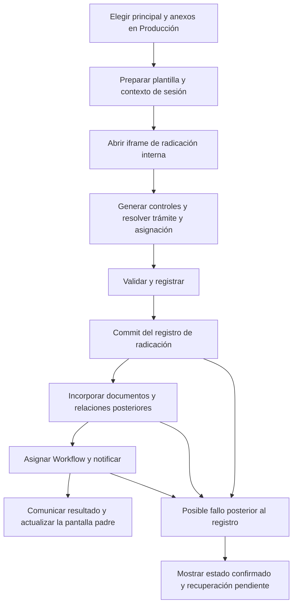

# Diagnóstico de radicación interna desde Producción documental

La radicación interna puede mejorar sustancialmente su claridad, pero necesita una revisión de comportamiento además del cambio visual. El formulario actual combina selección de documentos, una plantilla dinámica, asignación Workflow y una operación con varias etapas de persistencia. La modernización debe conservar esa configuración y distinguir lo registrado de los efectos posteriores que puedan fallar.

**Recomendación:** corregir primero las inconsistencias verificadas de dependencias, estado y comunicación del modal; después reorganizar la interfaz manteniendo los IDs, metadatos y reglas de la plantilla. El backend de registro requiere un trabajo separado y acotado para contexto, autorización y resultados parciales.

| Referencia | Valor |
|---|---|
| Fecha | 2026-11-25 |
| Versión | 0.1 |
| Base local | Commit `0c7beb83` |
| Grabación | `Grabación 2026-11-25 113145-radicacion-interna-revisa.mp4` |
| Duración | 78,80 segundos |
| Entrada observada | Producción documental, selección de archivos y opción Radicar |
| Página interna | `radicador/WebFormRadicacionEntranteInterna.aspx` |
| Alcance | Revisión del video, código y pruebas locales aisladas; sin cambios de aplicación |

## Qué muestra la grabación

Al comienzo aparece un expediente con siete documentos. Se intenta radicar sin la selección principal que espera el servidor y se muestra «Debe seleccionar el documento de la lista para radicar». Después se marcan documentos, se activa una fila y se abre el modal de radicación interna.

El formulario reúne en una franja superior el usuario que radica, trámite, anexos, fecha del documento, folios, fecha límite, asunto, flujo, asignación y usuario del grupo. Más abajo aparece un campo adicional obligatorio de la plantilla. La mayor parte del modal queda vacía y los desplegables de personas ocupan una zona considerable al abrirse.

El video permite observar apertura y edición de la interfaz. No muestra la confirmación final de un radicado ni acredita su persistencia, envío o correo. Los hallazgos del callback de éxito y las etapas de registro proceden del código y de pruebas aisladas, no de una radicación ejecutada durante esta revisión.

## Componentes y recorrido actual

| Responsabilidad | Ubicación |
|---|---|
| Preparar documento principal, anexos y abrir modal | [WebFormProducionDocumental.aspx.vb](../../../Gestion/WebFormProducionDocumental.aspx.vb), `ButtonRadicar_Click`, línea 1122 |
| Recoger casillas y fila activa | [WebFormProducionDocumental.js](../../../js/gestion/WebFormProducionDocumental.js), `asigna_id_seleccionados_cheked`, línea 2332, y `prevent_scrol`, línea 2255 |
| Contenedor y botón de cierre reales | [WebFormProducionDocumental.aspx](../../../Gestion/WebFormProducionDocumental.aspx), `Panel_radica_interno`, línea 1499 |
| Dependencias, formulario base y callback | [WebFormRadicacionEntranteInterna.aspx](../../../radicador/WebFormRadicacionEntranteInterna.aspx), cabecera y `CheckStatus` |
| Ciclo de carga y confirmación | [WebFormRadicacionEntranteInterna.aspx.vb](../../../radicador/WebFormRadicacionEntranteInterna.aspx.vb), `Page_Load`, `UpdatePnaelcontrolesradicacion_Load` y `Buttonradicar_entrante_Click` |
| Generar campos de la plantilla | [ClassGaProducionDocumental.vb](../../../Gestion/ClassGaProducionDocumental.vb), `Genera_Interface_Radicacion_Entrante`, líneas 4440 a 5402 |
| Registrar radicado y efectos posteriores | [ClassRadicador.vb](../../../radicador/ClassRadicador.vb), `Registra_Radicacion_entrante_interna`, líneas 1910 a 3213 |
| Trámite, plazo y asignación | [ClassRadicador.vb](../../../radicador/ClassRadicador.vb), `Seleccion_tipo_tramite`, línea 17557; `Seleccion_actividad_workflow`, 17692; `Seleccion_flujo_workflow`, 17816 |
| Eventos del navegador | [WebFormRadicacionEntranteInterna.js](../../../js/radicacion/WebFormRadicacionEntranteInterna.js), funciones de selección, redimensionamiento y plugins |
| Lista del usuario que radica | [Class_remit_dest_interno.vb](../../../radicador/Class_remit_dest_interno.vb), funciones de líneas 529 y 568 |

El flujo utiliza un modal AjaxControlToolkit con un iframe. La página padre escribe `RA_MODULO_SELECCIONADO` con plantilla y documento y conserva los anexos en `RA_ADJUNTOS_RADICADO_INTERNO`. La confirmación también toma `PG_SELECCION_ID_EXPEIDENTE` de la sesión. Las selecciones dependientes de Workflow tienen campos ocultos propios.

El último nodo expresa el tratamiento recomendado del resultado parcial. El código ya contempla errores después de registrar; no se debe interpretar todo el recorrido como una sola operación reversible.

## Hallazgos y prioridades

P1 identifica un punto funcional que debe abordarse antes de ampliar la experiencia; P2 identifica una mejora de claridad o robustez que necesita verificación específica. La prioridad no demuestra explotación ni un fallo ocurrido en el ambiente.

### H01 El documento principal y los anexos no se distinguen con claridad

**Prioridad P1. Evidencia de video y código.** `hdnEmailID` representa la fila activa y define el principal; las casillas se serializan en `hdnEmailID_sel` y pasan a anexos excluyendo el principal. Marcar casillas no satisface la validación de fila principal. La interfaz usa «archivos seleccionados» en algunos accesos, aunque la operación necesita estos dos conceptos.

Esto explica el aviso inicial sin atribuirlo a bloqueo del servidor. Se recomienda mostrar «Documento principal» con nombre y acción explícita para elegirlo, más una lista separada «Anexos». La cantidad, identidad y procedencia deben confirmarse al abrir y al radicar. No conviene solucionar la ambigüedad eligiendo automáticamente un principal distinto del acordado.

### H02 La distribución y tipografía proceden de un generador con medidas fijas

**Prioridad P2. Evidencia de video y código.** `Genera_Interface_Radicacion_Entrante` construye tablas, celdas con anchos fijos y tamaños de fuente de 8/9 puntos, y agrupa campos adicionales por columnas. La página agrega porcentajes y scroll sobre esos contenedores. El modal ocupa casi toda la pantalla mientras los datos se concentran arriba.

La mejora debe agrupar por tarea y permitir que controles y textos se adapten al ancho disponible. El campo adicional visible en el video procede de metadatos; no debe quedar codificado de forma fija en una nueva pantalla. Hay que conservar ID, tipo, obligatoriedad, catálogos, scripts, calendarios y valores de cada campo de plantilla.

### H03 jQuery se carga dos veces y se pierden plugins

**Prioridad P1. Código y reproducción local.** La página carga `jquery-3.4.1.min.js` en las líneas 9 y 38. Entre ambas cargas aparecen jQuery UI, gridviewScroll y otros recursos. Al volver a ejecutar jQuery se reemplaza el objeto global que contenía esos plugins.

Con los recursos locales reales, antes de la segunda carga `$.fn.autocomplete` y `$.fn.gridviewScroll` son funciones; después ambos quedan `undefined`. No significa que todos los controles visibles hayan fallado en la grabación: explica un defecto real de disponibilidad de extensiones en los caminos que las invocan.

La corrección necesita ordenar dependencias y cargar una sola instancia por documento, comprobando plugins compartidos. La [documentación oficial de jQuery](https://api.jquery.com/jQuery.noConflict/) también advierte sobre la coexistencia de instancias y plugins; la reproducción aquí utiliza exactamente la misma versión cargada dos veces.

### H04 El callback de éxito apunta al cierre de otro modal

**Prioridad P1. Código y reproducción local.** En `CheckStatus`, cuando `hiden000001` indica éxito, se busca y pulsa `ButtonSalir_visor_externo` del padre. El modal de esta operación declara `CancelControlID="ButtonSalir_radica_interno"`.

La prueba con el callback real y dos botones sustituidos registró una activación del cierre del visor y cero del cierre interno. El video no contiene la radicación final, por lo que no se afirma que ese cierre erróneo se haya observado allí.

La mejora debe definir un resultado explícito del iframe para su padre: éxito registrado, consecuencias pendientes y documento/contexto de origen. El padre debe actualizar el listado y cerrar o mantener el modal correcto según ese resultado, sin depender del botón de un visor ajeno.

### H05 El registro del manejador se repite en ApplicationLoad

**Prioridad P2. Código y prueba con la API de eventos sustituida.** `Sys.Application.add_load(ApplicationLoadHandler)` llama a una función que añade `CheckStatus` a `endRequest` en cada carga de aplicación. Tres invocaciones de esa función realizan tres registros.

La prueba verifica esas llamadas de registro; no reproduce el ciclo completo de Microsoft Ajax/IIS ni cuenta ejecuciones finales en producción. Se recomienda registrar una vez, o retirar el manejador previo de manera compatible, y comprobar postbacks repetidos sin cierres, plugins o actualizaciones multiplicadas.

### H06 El usuario mostrado y el campo oculto pueden quedar desalineados

**Prioridad P1. Código y reproducción local del manejador.** `selecion_usuario_wf_grupo()` copia el valor del desplegable a `Hidden_id_user_wf` únicamente cuando se invoca. El control se crea con `onchange`, mientras los handlers de cambio de actividad/flujo vacían y repueblan sus opciones. En las funciones revisadas no se ve una actualización equivalente del oculto para cada sustitución de catálogo.

La prueba aislada mostró selección visible `11` con oculto `7`; al ejecutar el manejador ambos pasan a `11`; al sustituir las opciones por un usuario `22`, la selección visible cambia a `22` y el oculto conserva `11`. Es una reproducción de la condición de sincronización, no de una asignación equivocada persistida.

El registro consume `Hidden_id_user_wf` en ramas de asignación. Debe verificarse la secuencia completa en WebForms: invalidar selecciones dependientes, fijar de forma coherente el valor inicial y comprobar en servidor que el responsable pertenece a la asignación/flujo vigentes. Seleccionar una opción visible no puede implicar silenciosamente otra identidad de ejecución.

### H07 El contexto del iframe depende de sesión mutable

**Prioridad P1. Riesgo de integración confirmado por las dependencias del código.** Padre e iframe comparten `RA_MODULO_SELECCIONADO`, anexos y expediente de sesión. El submit vuelve a leer estos valores. Abrir otra operación o pestaña puede cambiar ese estado; no se verificó una carrera real ni una radicación cruzada en el ambiente.

Se recomienda un contexto específico de la apertura que compruebe principal, anexos, expediente, plantilla, usuario y autoridad al confirmar. La selección visual previa y el permiso comprobado al abrir no son suficientes para acreditar que el contexto sigue siendo el mismo al ejecutar.

### H08 Las opciones de plantilla tienen referencias y asignaciones inconsistentes

**Prioridad P1. Defecto visible en código.** En el generador, alrededor de las líneas 4501 a 4534:

1. Se busca `Hidden_opcion_radicado_general`, mientras el markup declara `Hidden_Estado_opcion_radicado_general`.
2. Las comprobaciones posteriores a buscar los controles de cita/radicado general vuelven a comprobar la variable del campo fecha, no la referencia recién obtenida.
3. Los tres valores `Estado_opcion_fecha`, `Estado_opcion_cita_respuesta` y `Estado_opcion_radicado_general` se asignan sucesivamente a `hiden_Estado_opcion_fecha.Value`.

Esto desalinearía la representación oculta de la configuración. No se ha probado qué ramas o plantillas desplegadas dependen de cada valor. Antes de rediseñar condiciones de visibilidad/obligatoriedad hay que contrastar las tres opciones, sus controles y sus consumidores con combinaciones distintas; no asumir que todos los asteriscos de la pantalla reflejan correctamente la plantilla.

### H09 El registro puede quedar confirmado aunque falle un paso posterior

**Prioridad P1. Secuencia de código.** `Registra_Radicacion_entrante_interna` tiene 1304 líneas. El `Commit` aparece en la línea 2980; después continúan almacenamiento/caracterización de documentos, actualización del principal y anexos, asignación Workflow y notificación por correo. Hay ramas que indican que el radicado ya se registró pero quedó pendiente de envío.

Por tanto, un error final no significa que nada se haya creado. El botón se rehabilita al terminar el postback, lo que no equivale a protección durable frente a reintentos. La revisión no acredita idempotencia de extremo a extremo ni demuestra duplicados reales.

La interfaz debe separar al menos: rechazado antes de registrar, radicado registrado, incorporación/asignación pendiente, notificación pendiente y resultado incierto. Se necesita consultar el resultado confirmado antes de permitir repetir. Un fallo de correo no debe anunciarse como radicación inexistente.

### H10 Usuario autenticado y usuario por quien se radica necesitan una distinción explícita

**Prioridad P1 para validar autoridad; P2 para presentación.** La página ofrece solo el usuario actual o una lista de usuarios activos según `Radicar_enviar_documento_master_interno`. El valor elegido se utiliza al registrar la relación del remitente. La pantalla no explica esa diferencia entre actor autenticado y usuario representado.

La existencia de una opción no demuestra un fallo de autorización. Debe revisarse la regla que habilita representación, su ámbito de empresa y su revalidación al confirmar. `EnableEventValidation="false"` está declarado en la página, por lo que no debe confiarse en el simple hecho de que una opción apareciera en un combo. Activar esa validación de WebForms sin revisar el ciclo de controles dinámicos también podría romper postbacks; no es una corrección automática.

Se recomienda mostrar siempre al actor autenticado como contexto y ofrecer «Radicar en nombre de» solo cuando la capacidad esté confirmada.

### H11 Un trámite con cero días sale antes de resolver el resto de sus dependencias

**Prioridad P2. Rama confirmada en código.** `Seleccion_tipo_tramite` contiene `If numero_dias = 0 Then Exit Function` en la línea 17607, antes de continuar la resolución posterior de flujo/asignación y sin asignar allí retorno `YES`. La fecha y los combos dependen de los eventos del trámite.

Debe definirse el significado funcional de cero días: trámite sin vencimiento, inmediato u otra configuración. La condición no se corrige inventando una fecha. Es necesario probar esa configuración y cambiar trámite/flujo sin reutilizar selecciones anteriores.

La fecha del documento del video es heredada del documento seleccionado; no se concluye que sea errónea por ser antigua. Es distinta de la fecha límite de respuesta calculada a partir del trámite y calendario de días laborales.

## Propuesta de organización de la interfaz

La recomendación es conservar inicialmente el contenedor y la generación por plantilla, añadiendo una presentación por secciones con una sola área de desplazamiento útil. Una reescritura del registro no debe esconderse dentro de una tarea de CSS.

| Sección | Contenido | Comportamiento propuesto |
|---|---|---|
| Contexto de la operación | Expediente, principal, actor y plantilla | Resumen visible y verificable; no una banda con texto diminuto de la entidad. |
| Documentos | Principal y lista de anexos con cantidad | Roles explícitos; nombres completos y posibilidad de revisar la elección antes de confirmar. |
| Datos del radicado | Trámite, asunto, fecha del documento, folios y cita cuando aplique | Etiquetas legibles, obligatoriedad de la plantilla y mensajes junto al campo. |
| Trámite y destino | Fecha límite, flujo, actividad/asignación, grupo y responsable | Controles dependientes, estado de carga, valores anteriores invalidados y búsqueda en catálogos largos. |
| Datos adicionales | Campos de la plantilla, incluido el observado en el video | Esquema dinámico preservado; no codificar un formulario para una sola plantilla. |
| Confirmación y resultado | Resumen y acción Radicar; estado posterior | Una operación en curso, resultado confirmado y pendientes diferenciados; cancelar no equivale a revertir un radicado registrado. |

La lista de usuarios necesita búsqueda por nombre/cargo y ámbito autorizado. La fecha límite debe explicar su origen y si puede editarse. «Ver..» debe expresar qué flujo o diagrama abrirá y estar disponible solo para un flujo válido. El modo de radicación, relaciones y consultas existentes se preservan según la configuración real, aunque algunos paneles estén ocultos en esta entrada.

No se han aprobado aquí cambios de reglas, campos obligatorios, actor representado, cálculo de plazos o alcance de radicación. Esas decisiones se refinan por entrega antes de modificar el comportamiento correspondiente.

## Operaciones que deben preservarse

| Familia | Capacidades y contratos |
|---|---|
| Origen documental | Principal, anexos, expediente, estado abierto/cerrado y rechazo de documentos ya relacionados cuando corresponda. |
| Plantilla | Campos de sistema y adicionales, orden, tipos, catálogos, scripts, obligatoriedad, folios, fechas y cita. |
| Trámite | Catálogo interno, calendario laboral, plazo y dependencias de flujo/actividad. |
| Responsables | Usuario actual/representado, asignación directa o a grupo, usuario de grupo y validación de autoridad. |
| Workflow | Flujo, actividad de inicio, responsable y consulta del diagrama. |
| Relacionados | Nuevo radicado, anexo/relacionado y expediente/consulta previa cuando estén habilitados en este recorrido. |
| Persistencia | Consecutivo, datos, relación principal, anexos y estados intermedios reales. |
| Salidas | Documento del radicado, descarga/impresión, envío, notificación y recuperación de pendientes. |
| Integración visual | Apertura, postbacks, reconstrucción de controles, cierre correcto y actualización de la pantalla padre. |

La página no es un formulario HTML estático: los controles se reconstruyen también durante `UpdatePnaelcontrolesradicacion_Load`. Cambiar su ubicación/ID sin revisar postdata, ViewState y momento de creación puede romper campos y eventos. Ese ciclo necesita pruebas integradas, no solo comprobar que el formulario nuevo se ve bien.

## Verificación realizada

Se ejecutó un diagnóstico local en Chromium con recursos y funciones reales del repositorio. El arnés está en `.tmp/diagnostico-radicacion-interna-20261125/verificar-hallazgos.cjs` y su resultado en `verificacion.json`, ambos excluidos de Git.

| Comprobación | Resultado | Límite |
|---|---|---|
| Primera carga de jQuery/UI/gridviewScroll y recarga de jQuery | Los dos plugins pasan de `function` a `undefined` | Recursos locales; no evalúa toda la página ASP.NET. |
| Tres ciclos de la función `ApplicationLoadHandler` | Tres llamadas de registro a `endRequest` | API Sys sustituida; no certifica el dispatch completo de Microsoft Ajax. |
| `CheckStatus` con resultado de éxito | Clic en visor: 1; clic en cierre interno: 0 | Callback real, botones del padre sustituidos; no radica un documento. |
| Selección de usuario y sustitución de opciones | El oculto solo se sincroniza al llamar al manejador; puede conservar el valor anterior | Reproduce el estado del manejador aislado, sin asignación persistida. |

Las cuatro comprobaciones pasaron sus aserciones, sin peticiones HTTP externas ni errores de página durante la carga local de las dependencias utilizadas. No se ejecutó radicación, consulta de datos reales, correo, carga autenticada ni E2E del ambiente.

También pasó `node --test tests/bootstrap-table-global-contract.test.cjs`: cuatro comprobaciones estáticas de contratos compartidos de Bootstrap Table. Una parte inspecciona esta página; la suite no cubre la operación de radicación ni sustituye las pruebas integradas pendientes.

## Casos necesarios antes de aceptar una mejora

- Solo casillas, solo fila principal, principal también marcado y anexos excluidos/duplicados; resumen de la selección que realmente se enviará.
- Documento ya radicado, expediente cerrado, permiso retirado, usuario representado no autorizado y cambio de contexto en otra pestaña.
- Plantillas con opciones de fecha/cita/radicado distintas y campos adicionales de todos los tipos utilizados.
- Cambiar trámite después de elegir responsable; grupo con un usuario, varios o ninguno; valor visible coherente con oculto y servidor.
- Trámite de cero días y calendario laboral, sin imponer una interpretación de negocio nueva.
- Postbacks repetidos, catálogos con búsqueda, conservación de valores/foco y ausencia de registros duplicados de eventos.
- Éxito completo, error antes de registro, fallo después de commit, anexos pendientes, fallo Workflow, fallo de correo y respuesta perdida.
- Cierre/cancelación antes y después de registrar, actualización del listado padre y descarga/impresión del documento generado.
- Pantalla pequeña, zoom de navegador, teclado, lector de pantalla y etiquetas asociadas a controles dinámicos.

Las pruebas reales requieren autorización expresa de ambiente, cuentas y datos descartables conforme al [runbook](../../../tools/e2e/AGENT-RUNBOOK.md). Una prueba local con dependencias sustituidas no acredita un recorrido real ni permite afirmar ausencia total de regresiones.

## Orden recomendado de intervención

1. **Estabilización funcional acotada:** dependencias, registro único de eventos, callback del modal, sincronización de selecciones y opciones de plantilla. Verificar con la configuración real antes de ampliar la interfaz.
2. **Claridad y presentación:** principal/anexos explícitos, secciones, catálogos buscables, mensajes por campo y resultado visible. Conservar plantilla y contratos de la operación.
3. **Contexto y resultado de backend:** identidad de apertura, autoridad al confirmar, correlación y recuperación de efectos parciales. Ajustar por responsabilidades y consumidores, sin reescribir indiscriminadamente el motor de radicación.
4. **Aceptación integral:** controles dinámicos, distintas plantillas, casos de concurrencia y fallos parciales, pruebas autorizadas y revisión de todos los accesos.

El módulo tiene dependencias más amplias que una mejora visual aislada. Un presupuesto de tiempo para implementarlo debe considerar las decisiones de plantillas, representación de usuario y recuperación del registro, además de la distribución del formulario.
