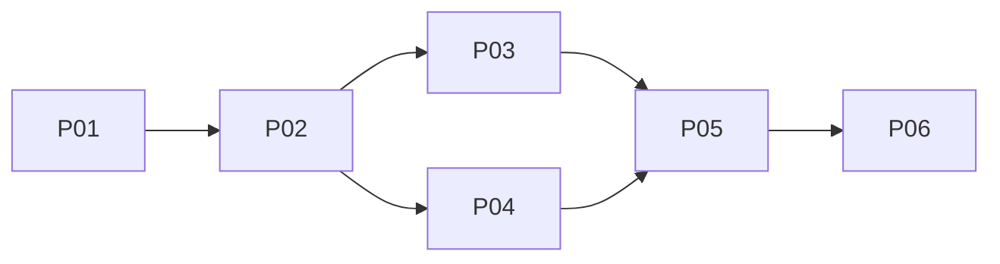

# Guía de implementación de radicación interna

La implementación queda organizada en **6 prompts**, conservando las 73 tareas de las 12 subfases anteriores: entrada desde Producción, carga directa, terceros como remitentes y entrega del seguimiento al módulo existente de respuestas. Los contratos se refinan al abrir la subfase que los consume; el diseño visual aprobado no aprueba por sí solo esas reglas. La reducción agrupa entregas, sin eliminar verificaciones ni ampliar el alcance.

Consolidación: 2026-11-26. Base de código revisada: `226d2000`; comprobar el código vigente al ejecutar. Estado de esta entrega: prompts y diagnóstico; aplicación sin implementar. Leer el [contexto común](contexto-comun.md), el [mapa de funciones](../mapa-funciones-implementacion.md) y la [revisión de prompts](revision-prompts.md).

P01 iniciado el 2026-11-26: [resultado parcial](../implementacion/P01-resultado.md), contratos, decisiones, inventario y caracterización disponibles en borrador. Continúa en refinamiento por G01; no se declara aceptado ni se inició código de aplicación de P02–P06.

## Qué cambia y qué se agrega

El mapa contiene **31 puntos de intervención/compatibilidad existentes (M01–M31)** y **13 responsabilidades nuevas propuestas (N01–N13)**. Son agrupaciones de funciones, controles y contratos, no 31 funciones que haya que reescribir ni 13 clases obligatorias. M24/M26 corresponden a consumidores de compatibilidad, con gestión de respuestas fuera del alcance.

| Área | Cambio necesario |
|---|---|
| Apertura y sesión | Adaptar `ButtonRadicar_Click` y `Page_Load` a una operación propia. La carga directa debe abrirse sin selección previa en Producción. |
| Formulario WebForms | Estabilizar dependencias, eventos y reconstrucción de controles; adaptar `Genera_Interface_Radicacion_Entrante` a datos sin documento previo. |
| Configuración | Separar seguimiento, modalidad y canal; corregir `Retorna_estado_respuesta_obligatoria` con sus consumidores y mantener calendarios/destinos. |
| Remitente | Agregar resolución tipada de interno/tercero, búsqueda y autorización. Mantener ejecutor autenticado y responsable interno independientes. |
| Documentos | D-RI-05: control independiente y recepción temporal. D-RI-07: almacenamiento y mapeos existentes intocables; adaptación únicamente externa con firmas vigentes, precondiciones y fuentes de metadatos comprobadas. |
| Registro | D-RI-06: caracterizar primero `Registra_Radicacion_entrante_interna` y sus consumidores; justificar cada adaptación/extracción mínima, conservar consecutivos/transacción y enlazar de forma durable la operación con su radicado. |
| Recuperación | Agregar consulta y finalización de fases pendientes. Un fallo posterior al `Commit` no debe volver a registrar el radicado. |
| Seguimiento de respuesta | Crear la obligación con modalidad, plazo y responsable correctos y entregarla al módulo existente. Elaboración, envío y cierre de respuestas quedan en ese módulo. |
| Interfaz | Integrar carga real, catálogos, plantillas, resumen, estados, salidas y recorridos condicionados comprobados. |
| Publicación | Incluir archivos en el proyecto, migración/configuración y evidencia integrada del recorrido operativo. |

## Prompts y orden de ejecución

| Paquete y prompt | Subfases conservadas | Depende de | Resultado verificable |
|---|---|---|---|
| [P01. Refinamiento y contratos](01-p01-refinamiento-contratos.md) | RI00 | Exploraciones y mapa | Contrato v1, alternativa documental y decisiones distribuidas. Sin código de aplicación. |
| [P02. Base WebForms, contexto y configuración](02-p02-base-webforms-contexto-configuracion.md) | RI01 → RI02 → RI03 | P01 | Estabilidad, operación autorizada, ambas aperturas, migración y configuración real. |
| [P03. Remitentes internos y terceros](03-p03-remitentes-internos-terceros.md) | RI04 | P02 | Remitente autorizado, ejecutor y responsable diferenciados. |
| [P04. Carga e incorporación de documentos](04-p04-carga-incorporacion-documentos.md) | RI05 → RI06 | P02 | Control nuevo independiente, recepción temporal real y documentos definitivos recuperables. |
| [P05. Registro, recuperación y seguimiento](05-p05-registro-recuperacion-seguimiento.md) | RI07 → RI08 → RI09 | P03 y P04; contratos P02 | Único radicado, fases recuperables y seguimiento disponible para el módulo existente. |
| [P06. Interfaz, integración y aceptación](06-p06-interfaz-integracion-aceptacion.md) | RI10 → RI11 | P01–P05 | UI real, ambos accesos, aceptación integrada y artefacto publicable. |

Los identificadores RI00–RI11 ahora nombran subfases internas de estos seis prompts y conservan referencias del mapa, tareas y decisiones. Los 12 archivos anteriores se sustituyen por esta serie; no hay que ejecutar ambas. P03 y P04 pueden avanzar independientemente una vez listo P02. P02/P05/P06 agrupan varias subfases: implementarlas y verificarlas en el orden indicado, sin exigir un solo commit para todo el prompt. RI07 crea la obligación; RI09 comprueba su entrega y no implementa respuestas.



El diagrama resume la secuencia; la tabla contiene las dependencias completas. No ejecutar todos los prompts como una sola instrucción sin revisar sus contratos y evidencia intermedia.

## Cómo refinar al implementar

Dar la instrucción de ejecutar un paquete junto con su contexto común. Por ejemplo:

> Ejecuta P01 de radicación interna con el contexto común. Conserva las decisiones vigentes D-RI-01, D-RI-02, D-RI-03, D-RI-05, D-RI-06 y D-RI-07; D-RI-04 quedó sustituida. Contrasta el código vigente, verifica la baseline del almacenamiento intocable y concreta contratos/caracterización; presenta las decisiones funcionales pendientes y compatibilidad de sus variantes. Avanza con lo independiente y registra los acuerdos. Este paquete no implementa aplicación.

Luego:

> Ejecuta P02 usando los contratos y acuerdos de P01. Completa RI01, RI02 y RI03 en ese orden, refinando las decisiones al abrir cada subfase. Implementa el alcance autorizado, conserva consumidores y trabajo ajeno, verifica comportamiento y registra evidencia y límites.

Al abrir cada paquete:

1. Contrastar código actual y resultados de dependencias. Una función propuesta no se trata como existente.
2. Cerrar sus decisiones necesarias del [registro G01–G11](contexto-comun.md), sin volver a pedir acuerdos previos ni convertir recomendaciones en aprobaciones.
3. Precisar entrada, salida, errores, autoridad, efectos, rutas y prueba de cada tarea. Versionar contratos antes de cambiar consumidores.
4. Implementar el alcance acordado y verificarlo. La autorización del trabajo local no sustituye la autorización expresa de ambiente/cuentas para E2E ni de despliegue.
5. Registrar durante la ejecución `implementacion/Pxx-resultado.md`, con estado y evidencia por subfase RI: funciones modificadas/agregadas, pruebas reales, decisiones, configuración, pendientes y siguiente consumidor. Existe el resultado parcial de P01; los siguientes se generan durante su ejecución, sin confundirlos con aceptación funcional previa.

La decisión transversal G01 se refina bajo D-RI-07: expediente previo puede utilizar el contrato existente; clasificación posterior requiere demostrar una ruta compatible sin modificar almacenamiento o metadatos protegidos. Si esa ruta no existe, no se habilita la variante ni se fabrica un ID cero o un almacenamiento paralelo. Las demás decisiones se cierran por paquete: catálogo/permisos de terceros, límites y folios, conservación del borrador y datos del seguimiento. D-RI-03 mantiene la gestión de respuestas en el módulo existente.

D-RI-06 exige tratar la radicación como núcleo crítico en los seis prompts. P01 inventaría contratos, consumidores, invariantes y casos de caracterización; el paquete funcional ejecuta esa caracterización antes de editar y compara el resultado después. P05 justifica y aplica únicamente cambios indispensables; P06 exige esa evidencia antes de aceptar la integración visual. La precondición es técnica y no solicita nuevamente aprobación del trabajo autorizado. Un control/ASMX separado no aísla tablas/clases comunes ni garantiza que baste un wrapper de la función actual. Se conservan los límites de autorización del ambiente y se documenta cualquier dependencia pendiente.

D-RI-07 prevalece sobre esa autorización genérica: `workflow/ClassAlmacenamiento.vb` y los mapeadores/vinculadores de la [baseline](../almacenamiento-intocable-baseline.json) no se modifican. Ejecutar `node tools/diagnostico/verify-radicacion-storage-freeze.cjs` antes/después de cada paquete, sin actualizar la baseline para permitir cambios. Leer el [diagnóstico de almacenamiento y metadatos](../diagnostico-almacenamiento-metadatos.md). La recepción/adapter nuevos preparan parámetros y evidencia propios; no clonan el motor, escriben sus tablas definitivas ni prometen reintentos automáticos si el efecto es incierto.

## Matriz mínima de aceptación

| Familia | Casos y evidencia exigidos |
|---|---|
| Origen | Producción conserva principal/anexos y expediente; acceso directo funciona en sesión nueva con archivos reales. No mezclar orígenes salvo acuerdo. |
| Identidad | Propia, representación interna permitida y tercero; mismo ID en dos catálogos; cambio/retiro de permiso; ejecutor y responsable correctos. |
| Plantilla | Campos/tipos/catálogos utilizados, fecha/cita/radicado, obligatoriedad, postbacks repetidos y valores/foco. No limitarse a Placa. |
| Asignación | Cambio de trámite/flujo/actividad/grupo, uno/varios/ningún usuario, cero días y calendario. |
| Recepción | Principal/anexos, duplicado, truncado, retiro/sustitución, límites, cancelación y dos pestañas. Comprobar contenido y recepción del servidor. |
| Confirmación | Doble clic, concurrencia, cambio de revisión, pérdida de respuesta alrededor del commit; un solo radicado, documentos y obligación para el mismo intento. |
| Finalización | Fallos documentales, Workflow y correo; consulta/reconciliación tras reiniciar IIS; conservar efectos reconocidos. |
| Seguimiento | Sin seguimiento no crea obligación; con modalidad de confirmación o respuesta formal crea una sola obligación con propietario/plazo correctos y lectura desde la bandeja existente. No exige responder ni cerrar el trámite aquí. |
| Salidas y capacidades condicionadas | Descarga/impresión, auxiliar/diagrama y copia/relacionados/expediente/catálogos si están conectados y habilitados. Documentar inactividad comprobada; no activar nuevas altas incidentalmente. |
| Consumidores | Producción, adjuntos clásicos/Simplificados y Workflow moderno conservan contratos/permisos. |
| Operación | Build y publicación, esquema/configuración aplicados según plan autorizado, acceso, artefactos y recuperación comprobados. |

Las suites locales existentes sirven como línea base; comprobarlas antes de ejecutarlas:

```powershell
node --test tests/bootstrap-table-global-contract.test.cjs tests/doc90-radicacion-classic-attachment.test.cjs tests/radicacion-simple-attachment-upload-signatures.test.cjs tests/workflow-user-send.test.cjs tests/workflow-group-send.test.cjs
```

Son pruebas focales y de contrato; no acreditan la nueva transacción ni el ciclo real WebForms. Cada paquete exige pruebas adicionales de comportamiento, MSBuild cuando cambie VB.NET/proyecto y validación integrada en infraestructura existente. Leer `AGENTS.md` y el runbook antes de la prueba autenticada aplicable; no ejecutar E2E/carga real sin ambiente, cuentas y datos descartables autorizados.

## Condición de cierre

La secuencia operativa es acceso autorizado → operación propia → recepción o referencias válidas → datos/identidades/destino → incorporación → único registro y obligación → Workflow/salidas → seguimiento disponible en el módulo existente → recuperación de pendientes de radicación. Una maqueta, un revisor de prompts o un build satisfactorio no acredita esta cadena. RI11 distingue implementación comprobada de aceptación pendiente y disponibilidad real. La elaboración y cierre de respuestas no forman parte de este alcance.
