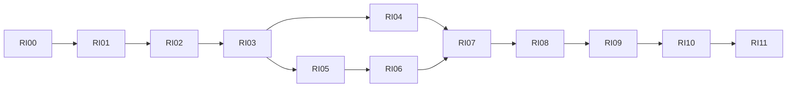

# Guía de implementación de radicación interna

La exploración permite preparar una implementación completa mediante 12 prompts: conservar la entrada desde Producción, agregar carga directa, admitir terceros como remitentes y hacer operativo el seguimiento de respuesta. Los contratos de expediente, permisos, terceros y respuesta se refinan al abrir el paquete que los consume. El diseño visual aprobado no aprueba por sí solo esas reglas.

Fecha: 2026-11-25. Base de código revisada: `226d2000`. Estado de esta entrega: prompts y diagnóstico; aplicación sin implementar. Leer el [contexto común](contexto-comun.md), el [mapa de funciones](../mapa-funciones-implementacion.md) y la [revisión de prompts](revision-prompts.md).

## Qué cambia y qué se agrega

El mapa contiene **31 puntos de intervención existentes (M01–M31)** y **13 responsabilidades nuevas propuestas (N01–N13)**. Son agrupaciones de funciones, controles y contratos, no 31 funciones que haya que reescribir ni 13 clases obligatorias.

| Área | Cambio necesario |
|---|---|
| Apertura y sesión | Adaptar `ButtonRadicar_Click` y `Page_Load` a una operación propia. La carga directa debe abrirse sin selección previa en Producción. |
| Formulario WebForms | Estabilizar dependencias, eventos y reconstrucción de controles; adaptar `Genera_Interface_Radicacion_Entrante` a datos sin documento previo. |
| Configuración | Separar seguimiento, modalidad y canal; corregir `Retorna_estado_respuesta_obligatoria` con sus consumidores y mantener calendarios/destinos. |
| Remitente | Agregar resolución tipada de interno/tercero, búsqueda y autorización. Mantener ejecutor autenticado y responsable interno independientes. |
| Documentos | Agregar recepción temporal propia, manifiesto versionado e incorporación definitiva compatible con la clasificación elegida. Los handlers de adjuntos posteriores al radicado conservan sus contratos. |
| Registro | Extraer el núcleo de `Registra_Radicacion_entrante_interna`, conservar consecutivos/transacción y enlazar de forma durable la operación con su radicado. |
| Recuperación | Agregar consulta y finalización de fases pendientes. Un fallo posterior al `Commit` no debe volver a registrar el radicado. |
| Seguimiento de respuesta | Crear la obligación con modalidad, plazo y responsable correctos y entregarla al módulo existente. Elaboración, envío y cierre de respuestas quedan en ese módulo. |
| Interfaz | Integrar carga real, catálogos, plantillas, resumen, estados, salidas y recorridos condicionados comprobados. |
| Publicación | Incluir archivos en el proyecto, migración/configuración y evidencia integrada del recorrido operativo. |

## Prompts y orden de ejecución

| Paquete | Prompt | Depende de | Resultado verificable |
|---|---|---|---|
| RI00 | [Refinamiento y contratos](01-ri00-refinamiento-contratos.md) | Exploraciones y mapa | Contrato v1, alternativa documental y decisiones distribuidas por paquete. |
| RI01 | [Estabilidad WebForms](02-ri01-estabilidad-webforms.md) | Alcance RI00 | Dependencias, eventos, opciones de plantilla, selección y modal estabilizados. |
| RI02 | [Operación, contexto y autoridad](03-ri02-operacion-contexto-autoridad.md) | RI00; RI01 al integrar apertura | Operación durable y autorizada, revisión, ambas aperturas y migración. |
| RI03 | [Plantillas, trámites y respuesta](04-ri03-plantillas-tramites-respuesta.md) | RI00, RI02 | Configuración tipada, calendario, destinos y modalidad correctos. |
| RI04 | [Remitentes internos y terceros](05-ri04-remitentes-internos-terceros.md) | RI02, RI03 | Remitente permitido y auditado, con identidad inequívoca. |
| RI05 | [Recepción temporal de archivos](06-ri05-recepcion-temporal-archivos.md) | RI02, RI03 | Archivos realmente recibidos y verificables por operación. |
| RI06 | [Incorporación documental](07-ri06-incorporacion-documental.md) | RI02, RI03, RI05 | Referencias definitivas y recuperación sin duplicar documentos. |
| RI07 | [Registro transaccional](08-ri07-registro-transaccional-idempotente.md) | RI02, RI03, RI04, RI06 | Único radicado/seguimiento por confirmación, con correlación durable. |
| RI08 | [Finalización y recuperación](09-ri08-finalizacion-recuperacion-salidas.md) | RI06, RI07; contratos RI03/RI04 | Workflow, notificación, salidas y pendientes recuperables. |
| RI09 | [Entrega del seguimiento](10-ri09-seguimiento-respuesta-workflow.md) | RI03, RI04, RI07, RI08 | Obligación disponible y legible por el módulo existente de respuestas. |
| RI10 | [Interfaz y accesos reales](11-ri10-interfaz-accesos-integracion.md) | Contratos implementados RI01–RI09 | Recorrido completo desde ambos accesos con UI compacta. |
| RI11 | [Aceptación y publicación](12-ri11-aceptacion-operativa-publicacion.md) | Entregas anteriores verificadas | Evidencia integral, artefacto publicable y recuperación/reversión. |

Los paquetes son unidades de alcance, no estimaciones de una jornada ni tareas necesariamente de un solo commit. RI04 y RI05 tienen requisitos independientes una vez listos RI02/RI03; mantener contratos compatibles. Puede avanzarse en composición de interfaz antes de terminar el backend, pero RI10 no se acepta con servicios simulados. RI07 crea la obligación dentro del núcleo; RI09 comprueba su entrega/consulta en el módulo existente y no la vuelve a insertar ni implementa la respuesta.



El diagrama resume la secuencia; la tabla contiene las dependencias completas. No ejecutar todos los prompts como una sola instrucción sin revisar sus contratos y evidencia intermedia.

## Cómo refinar al implementar

Dar la instrucción de ejecutar un paquete junto con su contexto común. Por ejemplo:

> Ejecuta RI00 de radicación interna. Conserva D-RI-01 y D-RI-02; contrasta el código vigente, concreta contratos y presenta las decisiones funcionales pendientes con su impacto. Avanza con lo independiente y registra los acuerdos. Este paquete no implementa aplicación.

Luego:

> Ejecuta RI01 usando los contratos y acuerdos registrados en RI00. Implementa el alcance autorizado, conserva consumidores y trabajo ajeno, verifica comportamiento y registra evidencia y límites.

Al abrir cada paquete:

1. Contrastar código actual y resultados de dependencias. Una función propuesta no se trata como existente.
2. Cerrar sus decisiones necesarias del [registro G01–G11](contexto-comun.md), sin volver a pedir acuerdos previos ni convertir recomendaciones en aprobaciones.
3. Precisar entrada, salida, errores, autoridad, efectos, rutas y prueba de cada tarea. Versionar contratos antes de cambiar consumidores.
4. Implementar el alcance acordado y verificarlo. La autorización del trabajo local no sustituye la autorización expresa de ambiente/cuentas para E2E ni de despliegue.
5. Registrar durante la ejecución `implementacion/RIxx-resultado.md`: funciones modificadas/agregadas, pruebas reales, decisiones, configuración, pendientes y siguiente consumidor. Estos resultados todavía no existen por generar los prompts.

La decisión transversal más importante es G01: expediente previo con incorporación compatible, o almacenamiento independiente y clasificación posterior. Ambas son posibles líneas de diseño; la segunda requiere implementar relaciones/almacenamiento propios. Los IDs cero no resuelven esa alternativa. Las demás decisiones se cierran por paquete: catálogo/permisos de terceros, límites y folios, conservación del borrador y datos del seguimiento. D-RI-03 fija que la gestión de respuestas y sus políticas permanecen en el módulo existente.

## Matriz mínima de aceptación

| Familia | Casos y evidencia exigidos |
|---|---|
| Origen | Producción conserva principal/anexos y expediente; acceso directo funciona en sesión nueva con archivos reales. No mezclar orígenes salvo acuerdo. |
| Identidad | Propia, representación interna permitida y tercero; mismo ID en dos catálogos; cambio/retiro de permiso; ejecutor y responsable correctos. |
| Plantilla | Campos/tipos/catálogos utilizados, fecha/cita/radicado, obligatoriedad, postbacks repetidos y valores/foco. No limitarse a Placa. |
| Asignación | Cambio de trámite/flujo/actividad/grupo, uno/varios/ningún usuario, cero días y calendario. |
| Recepción | Principal/anexos, duplicado, truncado, retiro/sustitución, límites, cancelación y dos pestañas. Comprobar contenido y recepción del servidor. |
| Confirmación | Doble clic, concurrencia, cambio de revisión, pérdida de respuesta alrededor del commit; un solo radicado, documentos y obligación para el mismo intento. |
| Finalización | Fallos documentales, Workflow y correo; consulta/reconciliación tras reiniciar IIS; conservar efectos reconocidos. |
| Seguimiento | Sin seguimiento no crea obligación; con modalidad de confirmación o respuesta formal crea una sola obligación con propietario/plazo correctos y lectura desde la bandeja existente. No exige responder ni cerrar el trámite aquí. |
| Salidas y capacidades condicionadas | Descarga/impresión, auxiliar/diagrama y copia/relacionados/expediente/catálogos si están conectados y habilitados. Documentar inactividad comprobada; no activar nuevas altas incidentalmente. |
| Consumidores | Producción, adjuntos clásicos/Simplificados y Workflow moderno conservan contratos/permisos. |
| Operación | Build y publicación, esquema/configuración aplicados según plan autorizado, acceso, artefactos y recuperación comprobados. |

Las suites locales existentes sirven como línea base; comprobarlas antes de ejecutarlas:

```powershell
node --test tests/bootstrap-table-global-contract.test.cjs tests/doc90-radicacion-classic-attachment.test.cjs tests/radicacion-simple-attachment-upload-signatures.test.cjs tests/workflow-user-send.test.cjs tests/workflow-group-send.test.cjs
```

Son pruebas focales y de contrato; no acreditan la nueva transacción ni el ciclo real WebForms. Cada paquete exige pruebas adicionales de comportamiento, MSBuild cuando cambie VB.NET/proyecto y validación integrada en infraestructura existente. Leer `AGENTS.md` y el runbook antes de la prueba autenticada aplicable; no ejecutar E2E/carga real sin ambiente, cuentas y datos descartables autorizados.

## Condición de cierre

La secuencia operativa es acceso autorizado → operación propia → recepción o referencias válidas → datos/identidades/destino → incorporación → único registro y obligación → Workflow/salidas → seguimiento disponible en el módulo existente → recuperación de pendientes de radicación. Una maqueta, un revisor de prompts o un build satisfactorio no acredita esta cadena. RI11 distingue implementación comprobada de aceptación pendiente y disponibilidad real. La elaboración y cierre de respuestas no forman parte de este alcance.
